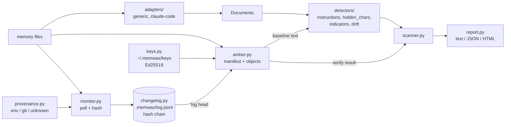

# Architecture

memwax has two halves that share one workspace: an **integrity** half (monitor, change log,
amber baselines) and a **content** half (adapters, detectors, reports). The integrity half never
looks inside files; the content half never decides what is trusted.



## Modules

| Module | Responsibility |
|---|---|
| `workspace.py` | Project root, `.memwax/` state dir, config, target discovery (globs + excludes). |
| `hashing.py` | SHA-256 helpers and canonical JSON (sorted keys, no whitespace) for anything hashed or signed. |
| `changelog.py` | Append-only JSONL log. Each entry = body + `prev` (previous entry hash) + `hash` (sha256 of the body). `verify()` reports edits, deletions, reorders and garbage lines. |
| `provenance.py` | Best-effort source of a change: declared `MEMWAX_SOURCE`, else git author when the working file equals HEAD, else unknown. |
| `monitor.py` | Polls target files, diffs against the state replayed from the log, appends `tracked/added/modified/removed` entries. |
| `keys.py` | Ed25519 key generation/loading outside the project, optional passphrase, trusted public keys. |
| `amber.py` | Create: hash files, store content in a content-addressed object store, sign the manifest (incl. log head). Verify: trusted signature, log head still present, drift. |
| `adapters/` | Format knowledge. `generic` (text; JSON/JSONL split into decoded string values) and `claude_code` (HTML comments, `@imports`, settings permissions). |
| `detectors/` | Format-agnostic rules over `Document`s. `normalize.py` undoes hidden-character obfuscation with an offset map so findings point at the original text. |
| `scanner.py` | Pipeline: discover files, verify the baseline, attach baseline text to documents, run detectors, de-duplicate. |
| `report.py` | Text (ANSI on a TTY), JSON, static HTML (no scripts, every value escaped). |
| `cli.py` | `init`, `watch`, `log show/verify`, `amber create/verify`, `key show`, `scan`. |

## Data on disk

```
project/
  .memwax/                 (has its own .gitignore: "*")
    config.json            targets, excludes, adapter
    log.jsonl              hash-chained change log
    amber/baseline.json    {"manifest": {...}, "signature": "<base64 Ed25519>"}
    amber/objects/ab/ab..  baseline file contents, addressed by sha256
~/.memwax/keys/
    amber_ed25519.key      private key (PKCS#8 PEM)
    amber_ed25519.pub      public key (base64, 32 bytes)
    trusted/*.pub          other keys whose baselines you accept
```

## Invariants the tests enforce

- A log entry's hash covers every field except itself; any edit breaks verification.
- The monitor's notion of "last known state" comes only from the log.
- Amber verification never trusts the public key embedded in the baseline.
- Stored baseline objects are re-hashed on read; a swapped object is ignored.
- Detectors, scanner and report never import a specific adapter.
- No Python source file in the repo contains non-ASCII characters (fixtures use escapes).
- The lab agent never executes a command.
